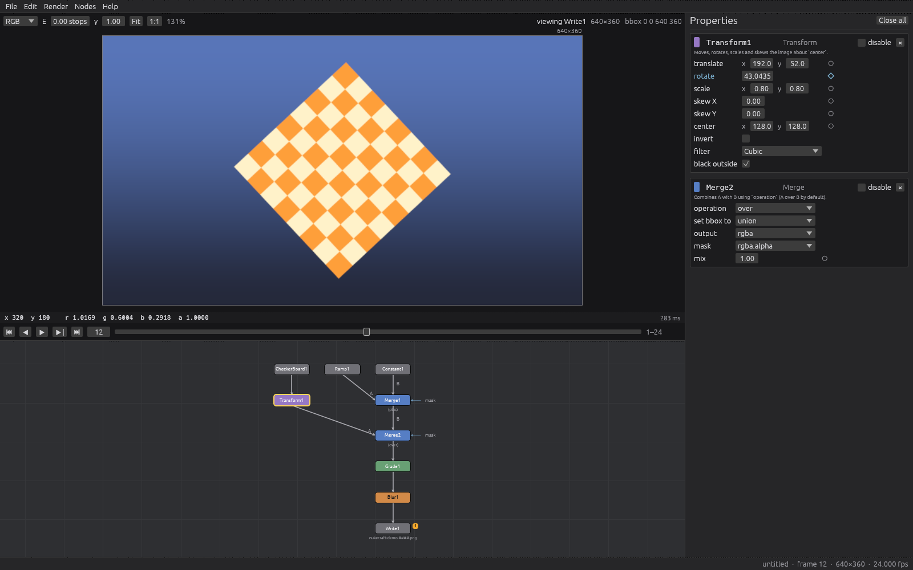

<h1 align="center">NukeCraft</h1>

<p align="center">
  <b>Node-based compositing; an open-source, clean-room compositor in the spirit of Foundry Nuke, built in pure Rust.</b>
</p>

<p align="center">
  
  
  
</p>

<p align="center">
  
  <br><sub>The desktop app with the demo script: Viewer, Node Graph and Properties.</sub>
</p>

## What NukeCraft is

NukeCraft is a node-based compositor: you build a graph of nodes (Read, Grade, Merge, Transform,
Blur, Write…), each with knobs, and the graph renders your shot. The aim is to feel familiar to anyone
who uses Nuke — the same node and knob names, the same image conventions (y up, bbox separate from the
format, linear-light premultiplied float, any number of channels), the same keyboard shortcuts — and
then to go further where it matters:

- **Everything is scriptable.** Every action is a command with an id, reachable from the command
  line and from an **MCP server for agents**, with undo for every edit.
- **A script file you can read.** Scripts are versioned JSON (`.ncs`) that diff cleanly; Nuke `.nk`
  import and export are planned.
- **Never crash.** Hostile files, values and parameters produce errors, not crashes; a failing command
  leaves the script untouched.

It is built the way the [ArtCraft](https://getartcraft.com/) **Crafting Apps** are built — PhotoCraft,
EffectCraft, FilmCraft and their siblings: layered pure-Rust crates, a command registry under every
frontend, agent control from day one, strict clean-room and asset rules, and a single quality gate
(`cargo xtask ci`). NukeCraft is an independent project, not part of that suite.

## Where it stands

**Pre-alpha.** The engine and a first desktop app work and are tested; the node library is small
and nothing has been compared with Nuke yet. Honest numbers are in [ROADMAP.md](ROADMAP.md) and the
shortfalls in [docs/gaps.md](docs/gaps.md).

What works today:

- **The desktop app:** a Node Graph (Tab search, B/G/M/T/K/./R/W to insert nodes, drag to connect,
  box select, 1 to view), a Viewer rendering on its own thread (channels, exposure, gamma, pixel
  readout, timeline and playback, on-viewer handles), a Properties panel (every knob kind, keys,
  one undo step per drag), a Curve Editor, Backdrops and StickyNotes, copy/paste, background
  rendering with progress, menus built from the command registry, undo/redo, autosave.
- **46 node classes:** Read, Write, Constant, CheckerBoard, ColorBars, Ramp, Rectangle, Radial, Grade,
  ColorCorrect, Saturation, Clamp, Invert, Multiply, Add, Gamma, Exposure (all with mask, unpremult
  and mix), Shuffle, Copy, ChannelMerge, Remove, Premult, Unpremult, Merge (29 operations, mask
  input), Keymix, Dissolve, Transform (six cubic filters + impulse, black outside), Reformat,
  Mirror, Position, CornerPin, FrameHold, TimeOffset, FrameRange, Blur (four kernels), Sharpen,
  Erode (fast and filter), Glow, Median, Crop, Switch, Dot, NoOp, Backdrop, StickyNote.
- **Nuke's image model:** bbox vs format, edge repeat outside the bbox, region-of-interest rendering,
  named channels and layers.
- **Animation:** keys on exact frame times, four interpolations, keying animated knobs.
- **Files:** PNG (8/16-bit) and OpenEXR (half/float, data windows, layers) in and out, frame-number
  patterns (`####`, `%04d`), all pure Rust.
- **Agents and the command line:** `nukecraft-cli` and an MCP server (`execute`, `list_commands`,
  `node_classes`, `get_script`, `render_image`).

## Get started

You need [Rust](https://rustup.rs/) 1.95 or newer.

```sh
cargo run -p nukecraft -- --demo                                # the desktop app, with the demo
cargo run -p nukecraft-cli -- demo demo.ncs
cargo run -p nukecraft-cli -- frame demo.ncs --node Write1 --frame 12 --out frame12.png
cargo run -p nukecraft-cli -- exec node.setKnob '{"node":"Blur1","knob":"size","value":8}' demo.ncs --save
cargo run -p nukecraft-cli -- render demo.ncs --frames 1-24     # writes nukecraft-demo.0001.png …
cargo run -p nukecraft-cli -- nodes                             # every node class and knob, as JSON
```

## Built for agents

`nukecraft-cli mcp --demo` speaks the Model Context Protocol over stdio; this repository ships a ready
[`.mcp.json`](.mcp.json). An agent can list node classes, create and connect nodes, set and animate
knobs, render any node to a PNG it can look at, undo, and save. With `nukecraft --control 9877` and
`nukecraft-cli mcp --bridge 9877` the agent works inside the running app, next to a person. The
UI can also run headless (`cargo run -p nukecraft-ui-egui --example snapshot`) so agents can click
through it and look at it without a display. See [docs/agents.md](docs/agents.md).

## How it's made

| Layer | Crates |
|---|---|
| L0 | `time` (exact frame time), `geom` (boxes, matrices, formats), `color` (transfer functions, Merge operations) |
| L1 | `raster` (multichannel images over a bbox), `curve` (animation) |
| L2 | `graph` (the script and `.ncs`), `nodes` (the node registry and built-in nodes) |
| L3 | `render` (pull-based evaluation), `io` (PNG, EXR, Read, Write) |
| L4 | `engine` (session, undo, commands) |
| L5 | `automation` (MCP), `ui-egui` (the desktop interface, headless snapshots) |
| L6 | `nukecraft` (desktop app), `nukecraft-cli` |

Details in [docs/architecture.md](docs/architecture.md). Contributors (people and agents) start with
[AGENTS.md](AGENTS.md) and [CLAUDE.md](CLAUDE.md); the plan lives in [plan/](plan/).

## License and credits

NukeCraft is licensed under either of [MIT](LICENSE-MIT) or [Apache-2.0](LICENSE-APACHE), at your
option. Every non-code asset is listed with its licence in [ATTRIBUTION.md](ATTRIBUTION.md).

Nuke is a trademark of The Foundry Visionmongers Ltd. NukeCraft is an independent, clean-room project
and is not affiliated with, sponsored by or endorsed by Foundry; see [NOTICE](NOTICE). The Crafting
Apps avoid their target's trademark in their names (PhotoCraft, not "PhotoshopCraft"), and this
project's name is still an open decision.
